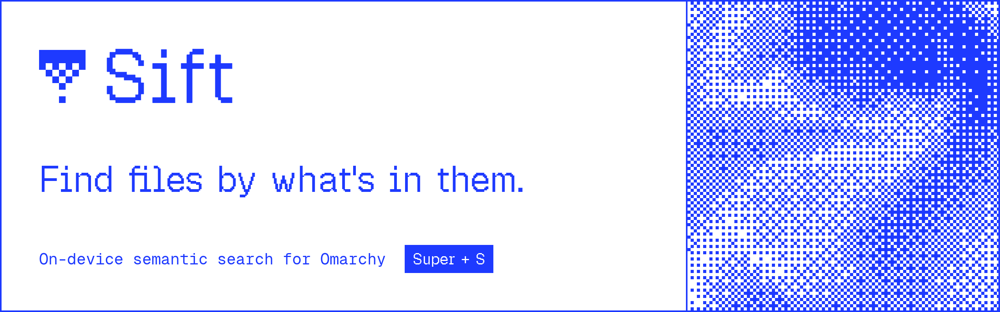

<h1 align="center">
  <picture>
    <source media="(prefers-color-scheme: dark)" srcset=".github/assets/banner-dark.png">
    
  </picture>
</h1>

<p align="center">
  <a href="#install">Install</a> ·
  <a href="#using-it">Using it</a> ·
  <a href="#folders">Folders</a> ·
  <a href="#people-opt-in">People</a> ·
  <a href="#hardware">Hardware</a> ·
  <a href="#how-it-works">How it works</a>
</p>

Press <kbd>Super</kbd> + <kbd>S</kbd> and describe what you're looking for: "the clause about pets in the lease",
"screenshot of a payment declined error", "python code editor with a rag script". Sift finds the photo, screenshot,
PDF page or document that matches, whatever it's called. Exact words count too: invoice numbers, error codes and
names are matched as written, including text read from screenshots.

Everything runs on your machine with Google DeepMind's [EmbeddingGemma 2](https://huggingface.co/google/embeddinggemma-2)
on [llama.cpp](https://github.com/ggml-org/llama.cpp) (Vulkan). Nothing you index leaves it.

Sift is a native Omarchy shell plugin: the search panel and the bar indicator live in `omarchy-shell` and follow
your theme.

## Install

```bash
omarchy plugin add https://github.com/ommgh/sift --enable
~/.config/omarchy/plugins/io.github.ommgh.sift/install.sh
```

The second line does the rest, in about 3 minutes the first time: it installs the packages it needs (asking first),
builds llama.cpp for your machine while the model (865 MB, checksummed) and the Python backend download, asks which
folders to read and which key opens Sift, and starts two user services. Skipped it? The Sift icon in the bar, or
`omarchy-shell shell toggle io.github.ommgh.sift`, offers to run it.

Run it again to update, after `omarchy plugin update io.github.ommgh.sift`. `sift doctor` shows what Sift runs on and what's missing.

### The shortcut

Omarchy already uses <kbd>Super</kbd> <kbd>S</kbd> for the scratchpad, so setup asks: Super + S (it says what the key
does now, and takes it over only while Sift has it), a free key, a key you type, or none (Sift is in the app launcher
either way). The choice is a marked block in `~/.config/hypr/bindings.lua`; change it any time:

```bash
sift shortcut pick                    # the same question again
sift shortcut set "SUPER + CTRL + F"
sift shortcut off                     # gives the key back
```

A Sift binding you wrote yourself is left alone.

## Using it

| Key | |
| --- | --- |
| type | search as you type |
| <kbd>↑</kbd> <kbd>↓</kbd> (or <kbd>Ctrl</kbd> <kbd>J</kbd>/<kbd>K</kbd>) | move through results |
| <kbd>Enter</kbd> | open it: PDFs at the matching page |
| <kbd>Ctrl</kbd> <kbd>Enter</kbd> | show it in the file manager |
| <kbd>Ctrl</kbd> <kbd>C</kbd> | copy the file, to paste anywhere |
| <kbd>Tab</kbd> | show weaker matches |
| <kbd>Ctrl</kbd> <kbd>S</kbd> | folders and people |
| <kbd>Esc</kbd> | clear, then close |

The bar indicator only shows while Sift is busy: hover for progress, click to search, right-click to pause.

From a terminal: `sift search "…"`, `sift status`, `sift pause` / `sift resume`, `sift folders`, `sift doctor`,
`sift config`.

## Folders

Setup asks which folders to read (it suggests Documents, Downloads, Pictures and the like, with how many files each
holds), and whether to read their subfolders too: a busy Downloads is often best read top level only.

Later, <kbd>Ctrl</kbd> <kbd>S</kbd> in the panel lists them with how far along each one is. <kbd>Space</kbd> turns
subfolders on or off, <kbd>Delete</kbd> (twice) stops reading one, and *Add a folder…* browses your home folder.
New and changed files are picked up as they appear. From a terminal:

```bash
sift folders                          # with how many files each holds and how many are read
sift folders add ~/Notes              # --top-level for just the files directly in it
sift folders remove ~/Downloads
```

## What it reads

In those folders:

- **pictures and screenshots** by what they show, plus the text in screenshots and PNGs (tesseract)
- **PDFs** page by page; pages without much text (scans, slides) are read as pictures
- **documents**: txt, md, rst, org, html, rtf, docx, odt, in ~450-token passages

Inside code projects (a folder with `.git`, `package.json`, …) only screenshots are read. It never reads hidden
folders, `node_modules` and the like, keys, certificates or `.env` files. It only reads: it never changes, moves or
uploads anything.

## People (opt-in)

Sift can also recognize faces, so you can search for someone: `om at a mountain`, `om and priya at the beach`, or
just `om` for every photo of them. It's off until you turn it on, in setup or in the panel: <kbd>Ctrl</kbd>
<kbd>S</kbd>, then <kbd>Tab</kbd> to People.

Once it has looked at your photos, People shows the faces it found, grouped by who they look like. Pick a group and
type a name; that's all. Naming another group with the same name adds it to that person. On a named person,
<kbd>Enter</kbd> searches for them and typing renames them; <kbd>Delete</kbd> forgets a person, or hides a group of
strangers so it isn't suggested again. <kbd>Ctrl</kbd> <kbd>Delete</kbd> turns people off and deletes every faceprint
and name. The same from a terminal:

```bash
sift faces on                         # downloads two small face models (37 MB)
sift person add om ~/Pictures/me1.jpg ~/Pictures/me2.jpg   # or from photos: 3–5 clear ones work best
sift person list
sift faces off
```

A face model separate from search does this: YuNet finds faces and SFace turns each into a faceprint (both from
OpenCV's model zoo, Apache 2.0, on the CPU, ~80 ms a photo). A query that names someone is limited to the photos
with their face, and the rest of the query ranks them. Faceprints stay in the local index like everything else.
It works best on clear, front-facing faces; profiles, sunglasses and tiny faces in wide shots are often missed.

## Hardware

Sift runs the model through Vulkan, so any GPU with a Vulkan driver works, and Omarchy installs one for AMD, Intel
and NVIDIA cards. Without one, it runs on the CPU. Measured on a Ryzen 5 5600H laptop:

| Runs on | A screenshot or PDF page | A text passage |
| --- | --- | --- |
| Discrete GPU (Radeon RX 5500M) | 1.9 s | 52 ms |
| Integrated GPU (Vega, in the CPU) | 1.8 s | 177 ms |
| CPU alone (6 cores) | 3.4 s | 334 ms |

Photos take about half a screenshot's time. Searching always runs on the CPU (~20 ms) and never wakes a GPU.

- **No discrete GPU:** fine. The integrated GPU is about as quick for pictures; the CPU alone is about 2× slower and
  uses every core, at idle priority.
- **NVIDIA:** works through the NVIDIA driver's Vulkan support (`nvidia-utils`, which Omarchy installs), no CUDA
  needed. On a laptop with two GPUs Sift picks the NVIDIA one, and stops using it whenever there's nothing to read.
  Not tested on NVIDIA hardware yet: `sift doctor --bench` shows what Sift found and how fast it is, and an issue
  with that output helps.
- **Choosing:** `device = "auto"` in `sift config` takes the discrete GPU, then the integrated one, then the CPU;
  `"dgpu"`, `"igpu"` or `"cpu"` pick one.

## Staying out of the way

Indexing is the only heavy part, and it's set up to run smoothly next to everything else:

- the model runs on the GPU (the discrete one if there is one), in a process that's **stopped whenever there's
  nothing to read**, so the GPU powers down and its memory is freed
- the indexer runs at idle CPU and disk priority: it takes only what the rest of the desktop leaves free, and backs
  off the moment you need the machine
- it waits while on battery (`ac_only`) and when paused (`sift pause`, or right-click the bar indicator)
- searches use the small text model on the CPU (a query is ~20 ms), so searching never wakes the discrete GPU; it's
  unloaded after 10 idle minutes

## How it works

```
folders ─► sift-indexer ─► readers (PyMuPDF, Pillow, tesseract)
                        ─► llama-server: EmbeddingGemma 2 Q8_0, text + vision, Vulkan, only while there's work
                        ─► ~/.local/share/sift/index.db: SQLite, a float16 vector per page, passage and picture,
                           plus FTS5 over names and text
panel ──socket──► sift (daemon) ─► query vector (CPU) ─► meaning + exact words ─► results
```

Ranking is a hybrid: each vector's similarity is put on the query's own scale per
modality, only files that stand out count as meaning matches, and the share of the query's words a file contains
adds on top (codes and numbers weigh words double).

## Privacy and safety

- Nothing leaves the machine. The model runs locally, over a Unix socket in your runtime folder: there's no network
  port, not even on localhost. The only downloads are the install's (llama.cpp at a fixed commit, the model and the
  face models, all checked by SHA).
- Only you can read what Sift keeps. The index holds your files' text, so it and the page previews and face crops
  are kept in folders only you can open (0700, files 0600).
- Sift only reads your files. It never changes, moves or uploads them, and it doesn't follow symlinks out of your
  folders.
- A downloaded file can't make it run away with memory. Every reader has a hard limit on what it decodes, and a file
  past it is skipped: 64 MB of unpacked DOCX/ODT text, 120 megapixels per picture, 16 megapixels per rendered PDF
  page, 5,000 passages per file. Pictures go only through the decoders for the types Sift reads.

## Uninstall

```bash
~/.config/omarchy/plugins/io.github.ommgh.sift/uninstall.sh   # --keep-index keeps the index, models and settings
omarchy plugin remove io.github.ommgh.sift
```

It removes the services, the shortcut, the launcher entry and the `sift` command, and gives back the key Sift took.
Your files are never touched.
